<div align="center">

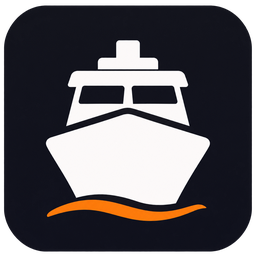

# VesselDesk

### Your vessel. One workspace.

Crew records, certificates, watch plans, printable cards and onboard calculations—together in a portable Windows app.

[](https://github.com/Barinovvvv/VesselDesk/releases/latest/download/VesselDesk-win-x64.zip)
[](https://github.com/Barinovvvv/VesselDesk/releases/latest)

**Windows x64 · Portable · Local storage · Works offline**

[Explore the app](#explore-the-app) · [Screenshots](#screenshots) · [Get started](#get-started) · [Updates](#updates) · [Support](#support)

</div>

<br>

[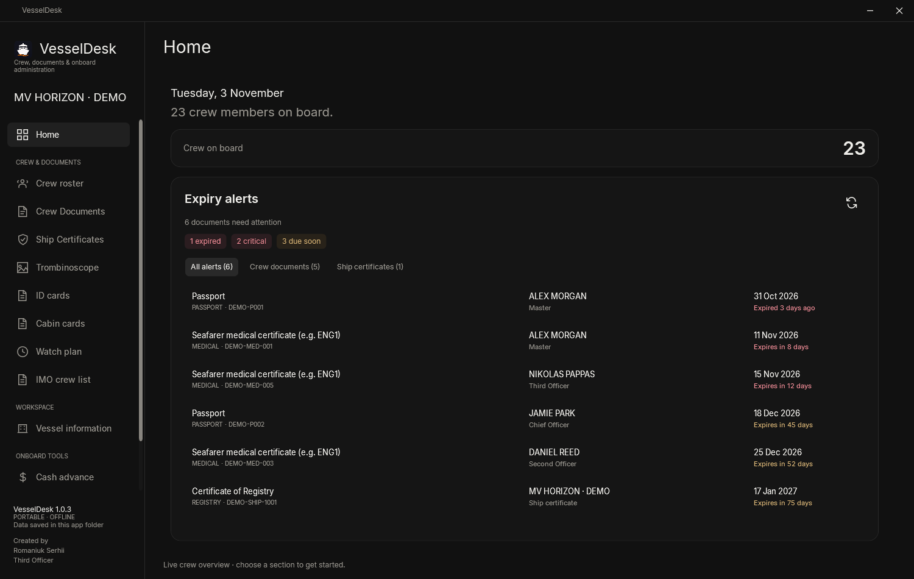](docs/images/home.webp)

<p align="center"><em>A clear view of your crew and the documents that need attention.</em></p>

## Built around everyday work on board

VesselDesk brings common vessel administration tasks into one desktop workspace. Import crew information from Excel, keep portraits and documents linked to the right people, prepare reports, and manage cash advances and beverage quantities without maintaining a separate workbook for every task.

The application runs from a folder without installation. Your records, photographs, attachments and settings stay in its local **Data** folder. Core features work offline; an internet connection is needed when checking for or downloading updates.

This repository hosts the public downloads, release notes and app documentation. A new installation starts with an empty crew database.

## Explore the app

| Workspace | What you can do |
| --- | --- |
| **Crew Roster** | Import an Excel crew database, review detected columns, edit values directly in the table, search the roster and manage portraits. |
| **Crew Documents** | Keep certificates and personal documents linked to roster identities, including numbers, dates, issuing authorities, notes and attachments. |
| **Ship Certificates** | Maintain a separate vessel certificate register with expiry information, annual review details where applicable, attached files and saved export selections. |
| **Home & Expiry Alerts** | Review expired and approaching-expiry documents, filter crew or ship records, and open the exact item that needs attention. Warning periods are configurable. |
| **Trombinoscope** | Generate a structured photo crew list with names and ranks, automatic wrapping and additional pages when needed. |
| **IMO Crew List** | Import and edit an independent crew list, add vessel and voyage information, preview the form, print it or export it to PDF. |
| **Watch Plan** | Organise separate officer and rating watches at sea and in port, plus gangway watch, day work, bridge team, pilot ladder and forward/aft mooring stations. |
| **ID & Cabin Cards** | Select crew members and generate printable cards using their current names, ranks and photographs. Cabin cards include nationality flags. |
| **Cash Advance** | Maintain monthly balances and advances, choose USD or EUR as the primary currency, enter an exchange rate and prepare printable/PDF allocations. |
| **Beer & Wine** | Calculate beer cases, bottles and volume, and wine bottles and volume. Add positions, retain the last values and see when they were updated. |
| **Vessel Information** | Store the ship name, call sign, IMO number, flag and company, plus the voyage details used by the IMO form. |
| **Settings & Backups** | Create and restore complete backups and check for signed application updates. |

## Screenshots

Click a screenshot to view it at full resolution. All examples below use **fictional demonstration data and generic avatar images**.

<table>
<tr>
<td width="50%" valign="top">
<h3>Crew Roster</h3>
<a href="docs/images/crew-roster.webp">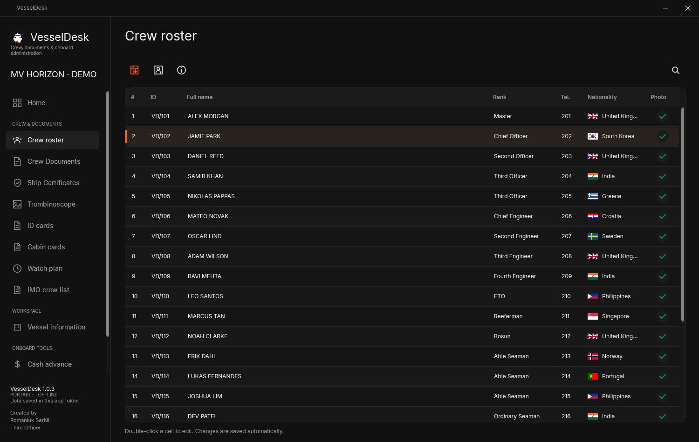</a>
<p>Current crew information, nationality flags, portrait status and quick search.</p>
</td>
<td width="50%" valign="top">
<h3>Crew Documents</h3>
<a href="docs/images/crew-documents.webp">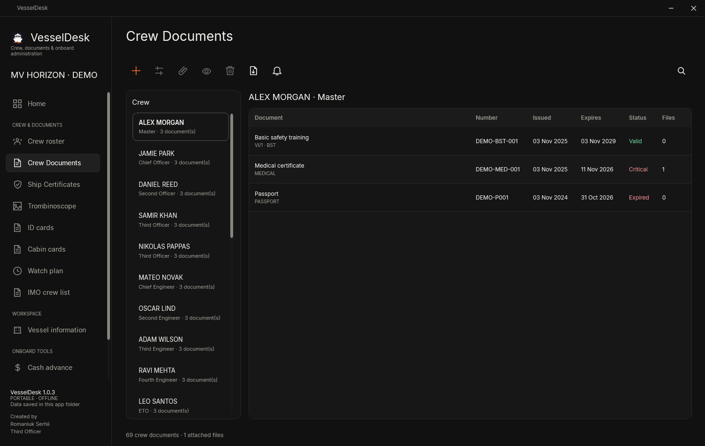</a>
<p>One place for each crew member’s certificates, dates and attached files.</p>
</td>
</tr>
<tr>
<td width="50%" valign="top">
<h3>Watch Plan</h3>
<a href="docs/images/watch-plan.webp">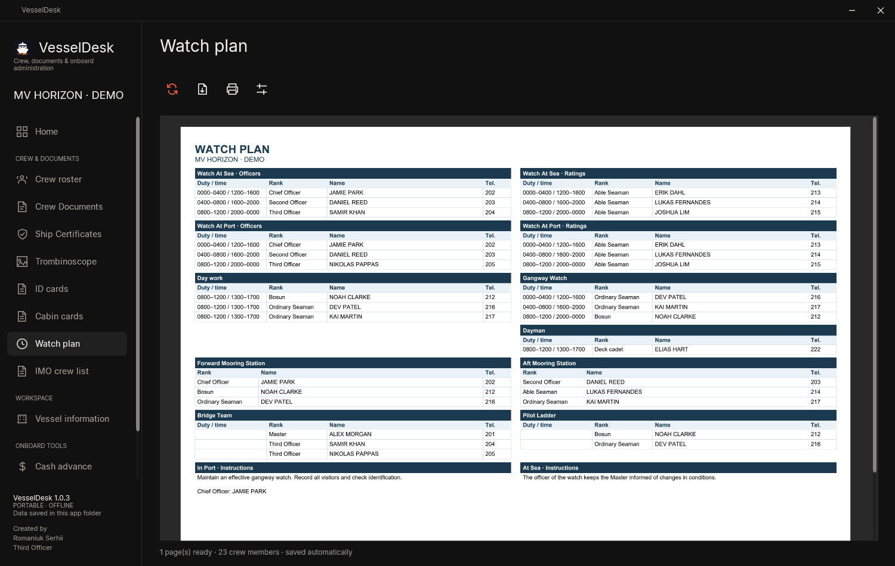</a>
<p>Flexible sections and live roster links, arranged into a printable plan.</p>
</td>
<td width="50%" valign="top">
<h3>Crew ID Cards</h3>
<a href="docs/images/id-cards.webp">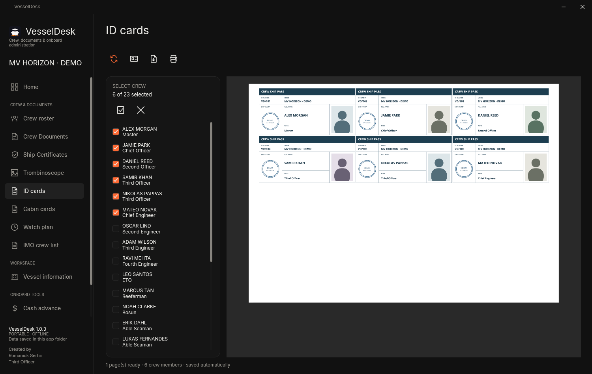</a>
<p>Consistent borders, fitted text, adjustable card dimensions and ship stamp replacement.</p>
</td>
</tr>
<tr>
<td width="50%" valign="top">
<h3>Cash Advance</h3>
<a href="docs/images/cash-advance.webp">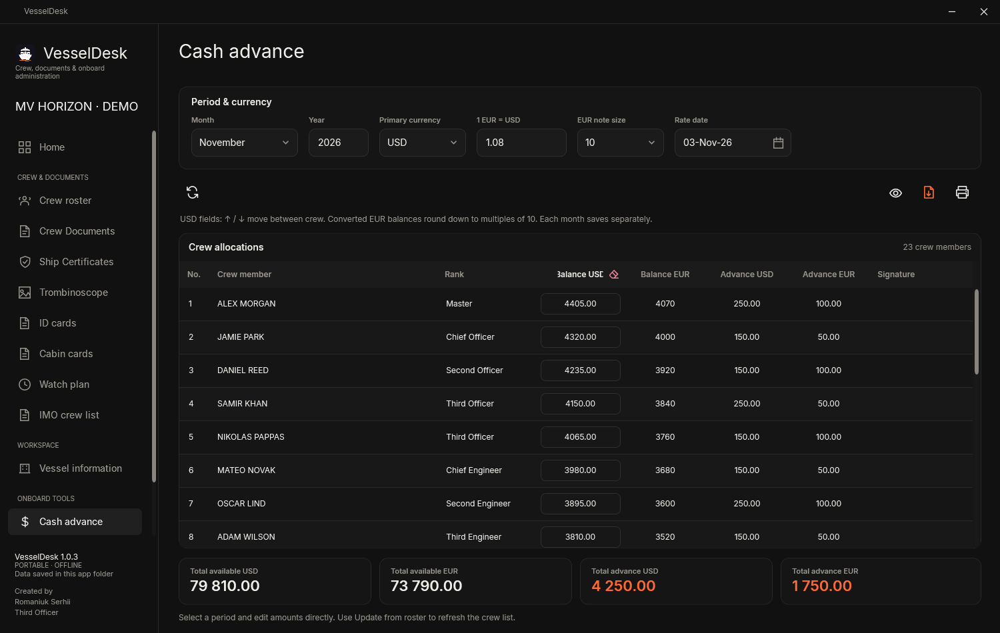</a>
<p>Monthly amounts, currency conversion and crew allocations in one view.</p>
</td>
<td width="50%" valign="top">
<h3>Beer & Wine</h3>
<a href="docs/images/beer-and-wine.webp">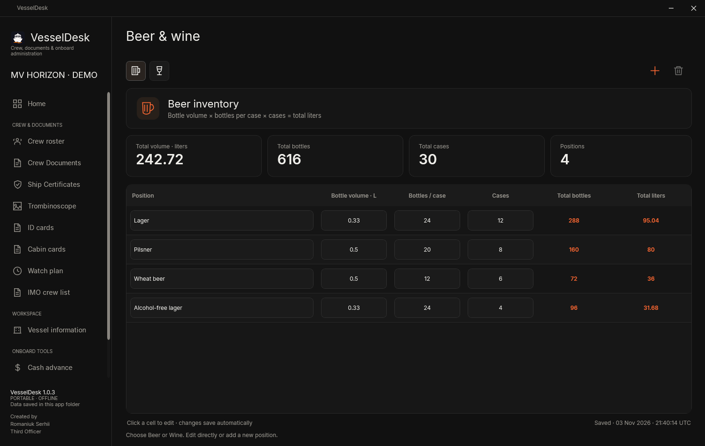</a>
<p>Clear quantity inputs and automatic totals for cases, bottles and litres.</p>
</td>
</tr>
</table>

<details>
<summary><strong>More screenshots: ship certificates, IMO crew list and Trombinoscope</strong></summary>

### Ship Certificates

[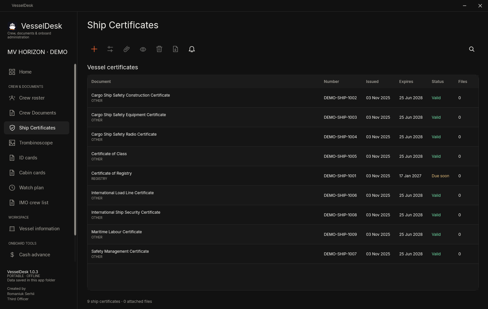](docs/images/ship-certificates.webp)

### IMO Crew List

[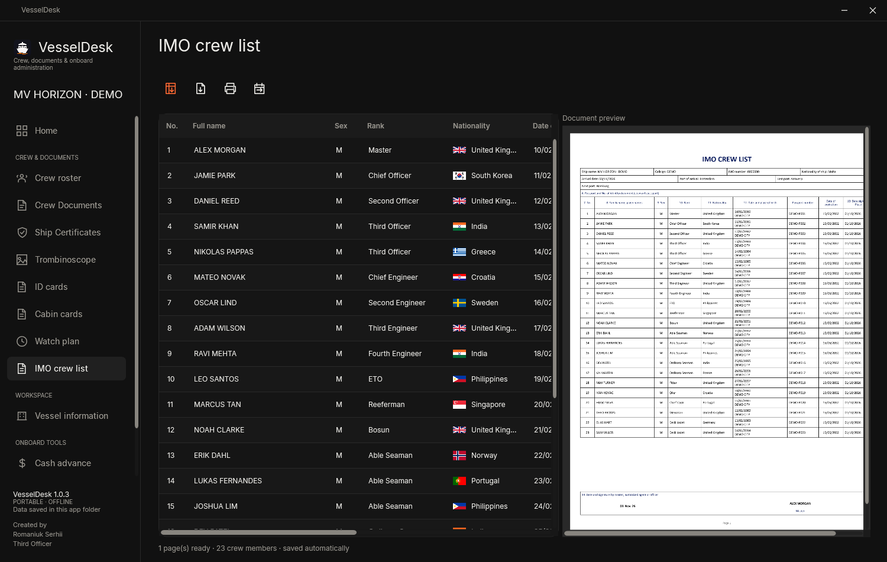](docs/images/imo-crew-list.webp)

### Trombinoscope

[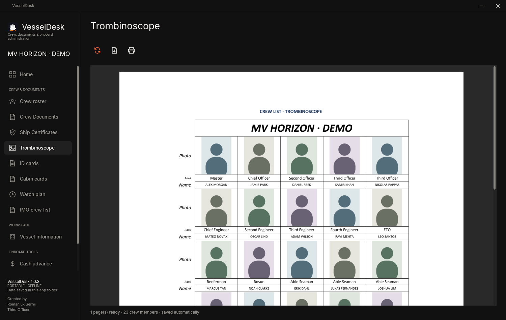](docs/images/trombinoscope.webp)

</details>

## Import your data, keep the connections

**Flexible Excel import.** Crew Roster and IMO Crew List search for recognisable headings across worksheets, including common field aliases and full or split names. Review the selected sheet, header and column mapping before applying the import. Manual mapping is available when automatic detection needs help.

**Portraits that stay with the right person.** Import from PDF or supported image files, choose a detected face or crop the portrait manually. Move or resize the crop, rotate pages and zoom while keeping the source proportions. Face detection runs locally. Matching crew identities retain valid existing portraits during imports.

**One roster for linked workspaces.** Crew Documents, Watch Plan, ID cards and cabin cards use roster identities rather than a second independently maintained list of names. The **IMO Crew List remains independent**, so a port-specific import does not overwrite the main roster.

**Nationality recognition.** Common country names, nationality adjectives and country codes resolve to the same offline flag—for example, Ukraine/Ukrainian and Sri Lanka/Sri Lankan.

## Documents, reports and output

- **Document attachments:** preview supported files and multipage PDFs inside the app. Use **Selective Export** to create a ZIP containing only the crew, document types and individual files you choose. Ship export selections can be saved as presets.
- **Printable reports:** IMO Crew List, Trombinoscope, Watch Plan, ID cards and cabin cards support preview, printing and PDF output. Long content wraps and larger selections continue onto additional pages.
- **Crew ID dimensions:** default **92 × 45 mm**, with a supported range of **85–140 mm wide** and **45–90 mm high**. Text and layout adapt to the selected dimensions. Print at actual size for accurate measurements.
- **Vessel and voyage fields:** separate ship name, call sign and IMO number; arrival/departure dates and ports; last and next port. Empty optional fields collapse in the IMO report.
- **Company branding:** choose from common shipping company presets or enter a custom company. Supported company logos appear on applicable reports. The CMA CGM SMS header is conditional on the selected company.
- **Watch assignments:** add, remove and reorder entries in individual sections, enter custom text and maintain separate In Port / At Sea instructions. A compact one-page layout is used when the plan fits; larger plans paginate.

## Get started

1. **[Download the latest portable ZIP](https://github.com/Barinovvvv/VesselDesk/releases/latest/download/VesselDesk-win-x64.zip).**
2. Extract the **entire archive** into a folder where you have write access. Keep the included files together.
3. Run **VesselDesk.exe**.
4. Enter the ship details and company in **Vessel Information**.
5. Open **Crew Roster → Import Excel**, review the mapping and import your crew.
6. Add portraits and documents, then use the report and onboard tool sections as needed.

**Requirements:** a 64-bit Windows PC. The portable package includes its application runtime; Microsoft Excel and Python do not need to be installed to use VesselDesk.

For a fresh installation, download **VesselDesk-win-x64.zip** from the release assets. The accompanying JSON manifest and signature are used by the built-in updater.

## Your data and backups

VesselDesk keeps its working data beside the application:

```text
VesselDesk/
├── VesselDesk.exe
├── Data/
│   ├── crew.db       Crew records, document metadata and settings
│   ├── Photos/       Crew portraits and replacement ship stamps
│   ├── Documents/    Attached crew documents and ship certificates
│   └── Backups/      Local backup files
└── …                 Runtime and application assets
```

Use **Settings & backups → Create backup** for a complete backup of the database, photographs, attachments and settings. Restore creates a rollback backup first. The app retains the two newest automatic backups.

To move to another PC, close VesselDesk and copy the **entire application folder**, including **Data**. Preserving only the executable will not transfer your records or attachments.

## Updates

1. Open **Settings & backups → Application updates**.
2. Select **Check for updates**.
3. Review the release notes and choose to download and restart.

The app verifies the signed update before replacing application files. Successful installation restarts VesselDesk and preserves the existing **Data** folder.

See [all releases and changelogs](https://github.com/Barinovvvv/VesselDesk/releases) for the history of changes.

## Support

Found an issue or have an idea? [Open a GitHub issue](https://github.com/Barinovvvv/VesselDesk/issues/new) and include the app version, what you were doing, what you expected and what happened. A screenshot or a small reproducible example is helpful.

---

<div align="center">

**Created by Romaniuk Serhii — Third Officer**

Crew, documents and onboard administration.

</div>
